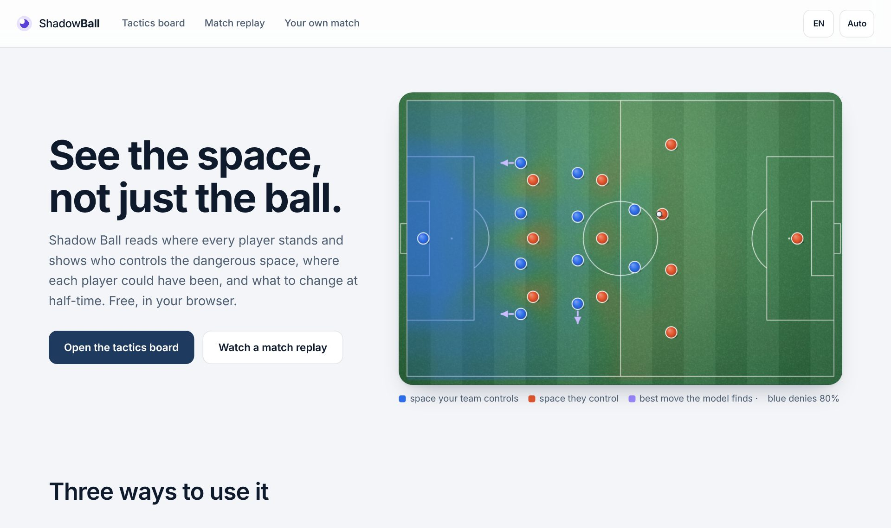
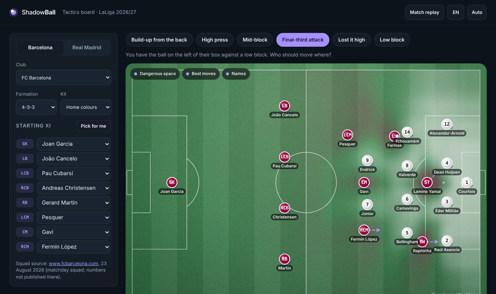
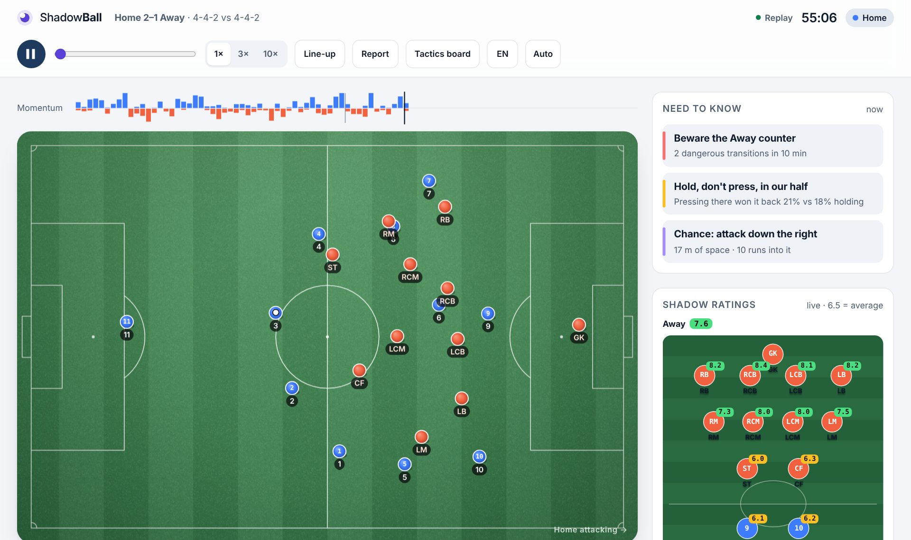
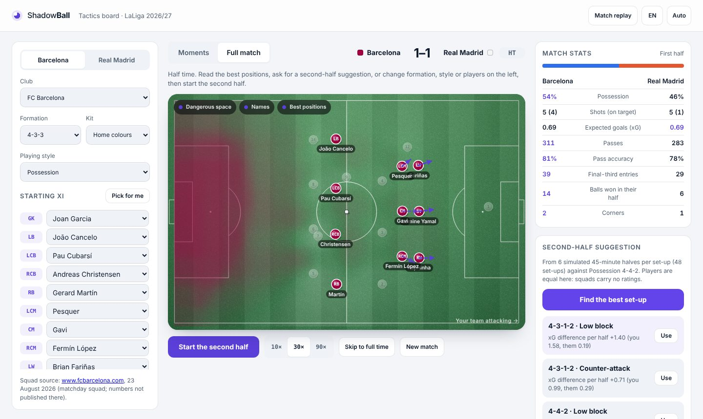

# Shadow Ball

A free coaching assistant for football, by [epinnn](https://github.com/Epinnn14). It reads where
every player stands and shows who controls the dangerous space, where each player could have been,
and what to change at half-time. Use it as a bench assistant, to prepare a match, or just to argue
about tactics with friends. English and Bahasa Indonesia, light and dark.

**[Open the website](https://epinnn14.github.io/shadow-ball/)** ·
[Tactics board](https://epinnn14.github.io/shadow-ball/playground.html) ·
[Match replay](https://epinnn14.github.io/shadow-ball/replay.html) ·
[Video calibration](https://epinnn14.github.io/shadow-ball/calibrate.html) ·
[Releases](https://github.com/Epinnn14/shadow-ball/releases)

[](https://epinnn14.github.io/shadow-ball/)

| Tactics board | Match replay |
| --- | --- |
| [](https://epinnn14.github.io/shadow-ball/playground.html) | [](https://epinnn14.github.io/shadow-ball/replay.html) |
| Pick two LaLiga 2026/27 sides, a formation, a style and the eleven. Moments: choose a scenario (build-up, high press, mid-block, final-third attack, a ball lost high, a low block), drag players and the ball. The model shows the dangerous space owned or denied, rest defence, the three best single moves and a four-player unit move. | Fifteen minutes of a real match (Metrica Sports open data, players by number) as a bench sees it: live pitch, Shadow pitch, pressing traps, fatigue, ratings, a half-time plan, a report. |

| Full match: half time |
| --- |
| [](https://epinnn14.github.io/shadow-ball/playground.html#match) |

**Your own match**: [play one in the browser](https://epinnn14.github.io/shadow-ball/playground.html#match).
Pick your LaLiga side and the opponent, a formation, a playing style and the players you like, and
watch 2 x 45 minutes. At half time the board shows where the model wanted your players and which
formation and style would suit the second half. See [Full match](#full-match).

Have video of your own game? Film from a high, wide angle; the Python tools in this repository turn
it into tracking on your computer, then [open the resulting `clip.json` on the site](https://epinnn14.github.io/shadow-ball/replay.html#own)
(read in the browser, never uploaded). See [Your own match video](#your-own-match-video).

Under the hood, from x/y positions only:

- **Movement without the ball** (the core): pitch control x a learned threat surface = the share of
  the dangerous space each team owns, every second. Space denied, rest defence, the best position
  each off-ball player could have reached, pressing traps and space leaks.
- **Possession** per frame: rule-based evidence decoded by a 3-state HMM; a small transformer fills in
  the ball when the camera loses it.
- **The web app** (`demo/`, plain HTML/CSS/JS, no build step, works offline): home, tactics board,
  replay, video calibration. Design notes at the top of `demo/style.css`; text in English with an
  Indonesian dictionary in `data_src/i18n_id.py`.

The project started as an entry to More Than A Hack 2027 (Metrica Sports x FC Barcelona); that part
is kept at the end of this file as history and still reproduces the submitted file.

## Publish the website

```bash
python run.py --game METRICA-2 cache && python run.py --game METRICA-2 ball-predict && python run.py --game METRICA-2 v4
python run.py --game METRICA-2 roles && python run.py --game METRICA-2 tactics && python run.py --game METRICA-2 offball
python run.py --game METRICA-2 demo
python scripts/build_playground_data.py   # squads + threat surface (needs the three open games' clips)
python scripts/build_i18n.py              # Indonesian dictionary
python scripts/build_site.py              # -> docs/
```

Commit `docs/`, then on GitHub: Settings > Pages > Build and deployment > Deploy from a branch >
`main`, folder `/docs`. The site is static; nothing runs on a server.

## Results on the open games

Scored against reference labels built from Metrica's event data (`sb/reference.py`: dead from a
ball out, foul or goal until the next set piece; owner = team of the latest controlling event,
sticky through lost balls and challenges). No parameter was set from these labels.

| Version | Game 3 (held out) | Game 2 | Game 1 |
| --- | --- | --- | --- |
| v0 organisers' baseline | 0.372 / 0.744 | 0.420 / 0.746 | 0.419 / 0.724 |
| v1 HMM | 0.514 / 0.761 | 0.535 / 0.747 | 0.533 / 0.776 |
| **v4.3** (submitted method) | **0.525 / 0.768** | **0.555 / 0.754** | 0.523 / 0.764 |

spellF1 / macroF1. The HMM is the big step (+0.10 to +0.14 spellF1 over the baseline on every
game); later versions sit inside a ~0.04 noise band. Game 3 is the honest test: ballnet only used
it to pick its stopping step. Details: `experiments/2026-11-20_open_games.md`.

The off-ball metrics replicate on all three open games, with no parameter changed:

| Game | Space denied: final third reached within 10 s, high vs low denial | Rest defence: final third conceded within 15 s, high vs low |
| --- | --- | --- |
| Competition match | 20.8% vs 30.9% | 6.1% vs 12.9% |
| Metrica 1 | 27.3% vs 38.0% (5/6 strata) | 6.6% vs 14.1% (5/6) |
| Metrica 2 | 28.1% vs 43.7% (6/6) | 7.7% vs 10.3% (4/6) |
| Metrica 3 | 15.3% vs 24.6% (6/6) | 4.3% vs 14.9% (4/6) |

The simple count of players behind the ball does not predict danger on any of them. See
`experiments/2026-11-20_phase2.md`.

## Run it on the open data

```bash
pip install -r requirements.txt
git clone https://github.com/metrica-sports/sample-data external/metrica-sample-data   # not committed
python run.py --game METRICA-2 cache        # parse the open game once
python run.py --game METRICA-2 ball-predict # ball reconstruction with the frozen model
python run.py --game METRICA-2 v4           # possession labels
python run.py --game METRICA-2 reference    # event-based reference labels
python run.py --game METRICA-2 score        # spellF1 / macroF1 against them
python run.py --game METRICA-2 roles && python run.py --game METRICA-2 tactics && python run.py --game METRICA-2 offball
python run.py --game METRICA-2 demo         # replay clip 55'-70'
python run.py --game METRICA-2 serve        # open the printed address (laptop + phones on the same Wi-Fi)
python scripts/build_site.py --game METRICA-2   # the website in docs/, no server needed
```

`--game` takes METRICA-1, METRICA-2 or METRICA-3 (`SB_GAME` works too); each game gets its own
folders under `cache/`, `submissions/` and `exports/`. On the open games players appear as
"Player" plus the shirt number: real names and photos are never shipped. Data: Metrica Sports sample
data, https://github.com/metrica-sports/sample-data.

## Your own match video

```bash
pip install -r requirements-video.txt                       # OpenCV + ultralytics (YOLO)
python run.py video frame match.mp4 --at 30                 # a still to calibrate on
# open demo/calibrate.html, load the still, click 4+ pitch landmarks, save calib.json
python run.py video track match.mp4 --calib calib.json --name my-match --camera moving --preview check.mp4
python run.py --game VIDEO-MY-MATCH ball-predict            # then v4, roles, tactics, offball, demo (printed)
```

YOLO finds the people and the ball (`--detector blobs` needs no model and suits wide tactical
cameras), the clicked landmarks map the image to the pitch, `--camera moving` follows pans and zooms
by matching the background to a keyframe, a pitch-space tracker links detections, and shirt colours
split the teams (referees dropped, keepers kept). The result has the same format as the competition
tracking, so every tool above runs on it. Tested on synthetic video rendered from open tracking with
known truth: 86-89% of players found within 2 m, median error 0.3 m (panning camera) to 1.1 m (far
static camera), 91-96% on the right team. Possession from video is still weak (macroF1 0.43 vs 0.72
from true tracking): dead balls are hard to tell from a missed ball. See
`experiments/2026-11-21_video_pipeline.md`. Use footage you have the right to use; the competition
video is licensed for the competition only.

## Tactics board

`demo/playground.html` (on the website): pick two LaLiga 2026/27 sides, a formation, a playing
style and the XI from each squad. **Moments** tab: choose a scenario (build-up, high press, mid-block, final-third attack, lost it
high, low block), drag any player or the ball, and read the model live: dangerous space owned or
denied, rest defence, the three best single moves and a simulated unit move of up to four players.
Pace per player can be set; it starts at 1.00x because squads list no speeds. Squads come from each
club's published list or its Wikipedia squad table (`data_src/laliga_2026_27.txt`, source and date
per club); no logos or photos. `python scripts/build_playground_data.py` rebuilds the data files.

### Full match

The **Full match** tab of the tactics board (`playground.html#match`) plays 2 x 45 minutes in the
browser with `demo/sim.js`, one step per second of match time. Each team takes the shape of its
formation and playing style (Possession, High press, Counter-attack, Direct, Wing play, Low block),
shifted with the ball: pressers step out, forwards hold the offside line, wing-backs drop into a
back five without the ball. The player on the ball picks a pass, through ball, carry, cross, shot or
clearance by expected value: the gain on the same threat surface as the model against the risk of
losing it. Shot xG comes from distance, pressure and bodies in the way. Live: score, possession,
shots, xG, passes, accuracy, final-third entries, balls won high, goals and big chances.

- **Best positions**: every 20 s of play the board runs the model's unit move (up to three players,
  each within 5 m) on the live positions. At a break it draws your players at their average position,
  with and without the ball, and an arrow to where the model kept wanting each of them.
- **Second-half suggestion**: a Web Worker (`demo/sim-worker.js`) plays every formation x style for
  your team (48 set-ups, six 45-minute halves each, the same seeds for all) against the opponent's
  set-up, and lists the three with the best xG difference next to your current one, flagging when the
  gap is within the simulation noise. One click applies it.

It is a tactics toy, not a forecast: squads carry no ratings, so players are equal apart from the
pace you set. Calibration (12 seeds, 4-3-3 vs 4-3-3): about 9 shots, 1.2 xG and 600 passes at 80 %
accuracy per team per match. `node tests/sim_test.js` checks determinism, the two halves, the
ranges and the search.

The whole interface follows the device's light or dark setting (or the Auto / Light / Dark button).

## Tactical layer

`python run.py roles` labels every player with a tactical position (GK, LB, LCB, RCB, RB, LCDM,
CAM, LW, RW, ST, ...) by matching each team's outfield players, frame by frame, to its average
out-of-possession shape (Hungarian assignment), and computes distance, high-speed running,
sprints and top speed per position per 5 minutes.

`python run.py tactics` then builds what the bench sees live: open-play turnovers with the
counter-press that followed (players within 10 m, ball won back within 5 s), progression and an
"open transition" flag; a nearest-player space map at every turnover with the best free zone; team
shape once per second (width, depth, defensive-line height, compactness) with alerts against the
first 15 minutes; and a Fatigue Risk Score per position from the drop in high-speed running and
distance. Outputs go to `exports/` (derived data, not committed).

## Bench screen on a laptop + phone (local server)

```bash
python run.py demo                      # replay clip, default 55'-70' -> exports/demo/clip.json
python run.py serve                     # prints the laptop and phone addresses
```

Before kick-off the coach fills a line-up card (round face, number, name under the face): he picks a
formation (18 shapes), then a position, then the player for it (search the squad, best fit for the
position first, or type a new name); "Fill one by one" walks through every position. The opponent's
card is optional (typed one by one or pasted as "number name" lines). Photos are the coach's own,
kept on the laptop only (none are bundled). Names are matched to the tracked players by position
(Hungarian assignment, both teams), so the chosen formation may differ from the detected one. Live,
the **Shadow ratings** card shows both line-ups with a rating per player: 6.5 + movement without the
ball (Shadow score vs the match average) + dangerous space held (vs the average for the position).
The laptop then shows the full bench screen. The live pitch is kept plain (players, names, ball).
Below it, the **Shadow pitch** is the core of the concept (`sb/offball.py`, once per second): the
dangerous space each team controls (pitch control x a threat surface learned from the match), our
share of it ("space denied" while defending, vs our usual), and for at most three of our off-ball
players an arrow to the best position he could have reached in that second, with the share of the
dangerous space it wins back. With the ball, the pitch also measures **rest defence**: the share of
our own dangerous space we would still own if we lost the ball right now (validated: the opponent
reaches our final third within 15 s 6.1% vs 12.9% of the time, high vs low; the simple count of
players behind the ball does not predict it). When it is thin, amber cover arrows are shown.
Only moves worth 1.5%+ and already there a second earlier are shown,
so the pitch stays quiet while the shape holds. **Shadow Replay**: when the opponent enters our final
third after our space denial fell into its lowest 35% in the previous 10 s, the Shadow pitch freezes
for 7 s on that second (also on the phone) and the Copilot feed keeps it; the same moments for the
opponent show where they leave space. **Shadow Ball** (the uncertainty cloud of a reconstructed ball)
is drawn there too. Then two **simulation cards** (the off-ball model run forward, in the browser):
from a real second of the last 30 s, up to 4 of our players move together (each within 5 m), chosen
greedily so each move counts the ones already made. Defend = our weakest second while they had the
ball (space denied before -> after); Attack = our latest second with the ball (space owned before ->
after, and what it costs the rest defence). Each card loops now -> simulated. Without the off-ball
outputs they fall back to the 30 s heat maps. The Defend card also says when the ball is in one of
our pressing trap (or leak) zones. **Pressing traps**: per zone, how often pressing won the ball back
within 5 s vs holding the shape, and how often the opponent then reached our box (us / them tabs).
**Space leaks**: per position, the dangerous space he leaves on the table now vs his first 15 minutes;
Plan B uses it (a tired player who still holds his space is a lower priority; one who leaks is the first
substitution). Then a fatigue map,
a Copilot feed with a mini-pitch per event, and movement per player with a heatmap. On top:
"Need to know", the three things that matter now, ranked from all modules (fatigue, counter-attacks,
the channel the opponent uses, pressure, space denial dropping, the last Shadow Replay, line height, a dangerous opponent, a chance);
a momentum chart (minutes with the ball in each final third); and attack channels (final-third
entries left/centre/right for both teams over 15 minutes). The phone also gets "Need to know". Two more cards: set pieces (every restart after a dead ball,
classified by where it is taken: corner, free kick in the final third, other free kick, throw-in,
goal kick; whether the team kept the ball 10 s later and reached the box) and 1v1 duels (for each of
our defenders, the opponent he meets most in our half over 10 minutes: how often that opponent is
goal-side of him and who wins the sprints). "Report" opens a three-page A4 report (print or save as
PDF) for half-time or the team meeting: the score and the usual match statistics per half and in total
(possession, number and length of possessions, chances created, counter-attacks, dangerous transitions,
final-third and box entries, long balls, ball wins, counter-press regains, corners, free kicks,
throw-ins, goal kicks, team distance and sprints), momentum, the three priorities and the advice, then
the maps, then a Shadow Ball page: space denied and rest defence per 5 minutes for both teams, the
pressing traps, the Shadow ratings of our XI, the space leaks and every Shadow Replay so far. Before kick-off the coach can also edit each player's profile (positions he can play, foot, three
keywords); the **Player Recommender** ranks the bench for a role from position fit, the traits the
situation needs and the foot, and **Plan B** ranks the options (substitution, a deeper line, a back five
on the side they attack, the first-half counter-press, an overload where the space is) and shows the
effect it measured by moving our players in the last 30 s of tracking (their control of our third,
before / after). Everything the laptop shows is posted to `/api/snapshot` and written to
`exports/demo/decisions.json` for the LLM Bench Copilot; the squad profiles go to
`exports/demo/players.json`. Goals, chances, counter-attacks, box entries, long balls and set-piece types come from
Metrica's Smart Tagging; the rest from our pipeline. Shots are not reported: the data has no shot
events and the tactical camera often loses the ball in front of goal. A phone on the same Wi-Fi or on the laptop's
hotspot opens the printed address and gets the pitch (upright) plus movement per position, and
follows the laptop's clock. For the competition match the clip is derived match data: it is served only from the laptop on
the local network and never uploaded. Clips from the open games can be hosted (`scripts/build_site.py`). No internet or CDN is needed.

## Half-time screen and chemistry

From the second half the laptop adds a half-time block (`sb/phase2.py`, built into `clip.json` by
`python run.py demo`). Everything uses only what was known at that moment.

- **Plan**: first-half grades, us vs them (space denied, rest defence, possession, threat created,
  pressing wins, counter-press, final-third entries) and up to three attacking and three defending
  suggestions from transparent rules, each with its evidence ("14 of our 29 final-third entries came
  down the left"). No language model writes them.
- **Possession and threat**: possession this half, and per minute the threat each side created (the
  learned chance of reaching the box within 10 s from where it had the ball), with goals marked;
  team heatmaps for the first half.
- **Passing network** (open games only: needs event data): passes, success, forward / long / switch
  / into the final third / followed by a shot, and the network of 2+ pass links.
- **Chemistry** per pair of neighbours in the formation: keeping a healthy distance, moving
  together, and one holding his line while the other pushes on. It is our own indicator and has not
  been validated against outcomes.

## The core: movement without the ball

```bash
python run.py offball                   # ~50 s: every off-ball player, every second of play
```

A pitch-control model (arrival times) weighted by a threat surface learned from the match gives one
objective for both teams: the share of the dangerous space a team owns. With the ball you want it;
without it you take it away ("space denied"). For every player off the ball, every second: his
contribution (what the team loses without him), what his last second of movement was worth, and his
**shadow**, the best position he could have reached. Validity: when the defending team denies the most
dangerous space, the attackers reach the final third within 10 s in 20.8% of moments, against 30.9%
when it denies the least (ball zone and team held fixed). See `experiments/2026-10-30_offball_shadow.md`.

# History: More Than A Hack 2027

Shadow Ball began as team Látigo AI's entry to More Than A Hack 2027, Phase 1: one possession label
per frame of FC Barcelona vs Athletic Club (H / A / D / X). It did not reach the top 20. The sections
below document that work.

## Phase 1: reproduce the submitted file

The competition match (`--game BAR-ATH`, the default) stays supported and regenerates the
submitted file unchanged. Its data is licensed for the competition only and is not in this repository.

Python 3.10 to 3.14. Every package is pinned in `requirements.txt`, PyTorch included; its CPU
build is enough, no GPU needed.

```bash
pip install -r requirements.txt
export MTAH_DATA_DIR=/path/to/data      # the match bundle, with the file names it arrives with
                                        # (Windows PowerShell: $env:MTAH_DATA_DIR = "C:\path\to\data")
python run.py cache                     # parse the tactical ATD once (~20 s)
python run.py ball-predict              # unseen ball from the frozen weights models/ballnet.pt (CPU, deterministic, ~1.5 min)
python run.py v4                        # v4.3 labels -> submissions/v4_restart.csv, validated, SHA-256 printed
```

Expected output of the last step:

```
sha256 c3eb7ed644caa73e94d5f03764c34c8bc6ba1f6e380dc097fe068a2c4b9ce502
{'H': 53141, 'A': 36899, 'D': 68817, 'X': 0, 'possessions': 275}
```

`python run.py validate submissions/v4_restart.csv` runs the organisers' checks again.

**Do not run `ball-train` to reproduce.** It retrains ballnet and overwrites `models/ballnet.pt`; GPU
training isn't bit-for-bit reproducible, so a retrained model gives a slightly different (equally
valid) file. The weights in `models/ballnet.pt` (SHA-256 `7e408f52…6b4e87`, model parameters
only) are the ones the submission was made with.

### How the ball model is trained: external data only

Following the organisers' rules clarification (3 Nov 2026), ballnet is trained and early-stopped on
**external data only**: the open [Metrica Sports sample data](https://github.com/metrica-sports/sample-data)
(three games; games 1 and 2 train it, game 3 picks the stopping step). It never sees the competition
match, which is only an input when the frozen model fills the missing ball. Nothing in the pipeline
is trained or tuned on the competition match, its ground truth or its video.

```bash
git clone https://github.com/metrica-sports/sample-data external/metrica-sample-data   # not committed
python run.py ball-train                # up to 60,000 steps, early-stopped on game 3 (best: step 50,500), writes models/ballnet.pt
```

About 30 minutes on a laptop GPU (`SB_DEVICE=cpu|cuda|mps` forces the device); `MTAH_EXTERNAL_DIR`
points elsewhere if the sample data lives in another folder. Data source: Metrica Sports, sample
data, https://github.com/metrica-sports/sample-data.

The match data is not in this repository and must not be: it is licensed for the competition only.

## Phase 1 versions (competition match)

| Version | Idea | Public 5-min spellF1 (sanity check only) |
| --- | --- | --- |
| v0 | Organisers' baseline, vectorised (nearest player + ±2 s majority) | 0.3256 (full match: 0.2433, published) |
| v1 | Dead-ball detection (activity, ball over a line until the restart, Smart Tagging hint) + sticky possession decoded by a 3-state HMM | 0.5125 (public noise band ±0.36: not proof) |
| v2 | v1 + ball reconstruction (self-supervised transformer over the players; 2.9 m median error vs 5.6 m for interpolation, cross-half) | same as v1 when the ball is visible; with the ball hidden on ~41% of the public window: 0.444 vs v1 0.419 (8 random masks, model trained on half 2 only) |
| v3 | v2 + fouls and other stoppages with the ball still on the pitch: inferred whistle (collective deceleration that stays slow) latched until the restart, 10 s activity, ball placed inside the pitch | 0.5091 (macroF1 0.855 vs 0.760); ball hidden: spellF1 0.445 vs v2 0.444, macroF1 0.797 vs 0.731 |
| v4 | v3 + the ball is live from a seen restart kick on (a stoppage latch that ends on a kick pushes "alive" for 5 s), fixing dead-ball stretches that ended 1-5 s late | 0.5455 (macroF1 0.872); ball hidden: spellF1 0.464 vs v3 0.445, never worse in 8 masks |
| v4.1 | v4 with better restarts: the ball reappearing already moving fast after an unseen stretch ends a stoppage; a 0.4 s placement is enough | 0.5455 (macroF1 0.900, transitions F1 0.46); ball hidden: spellF1 0.473 vs v4 0.464, never worse |
| v4.2 (withdrawn: ballnet trained on the match) | v4.1 + dead ball before the second-half kick-off (detected from the players: both teams still in their own halves, then a burst), with ballnet retrained for 40,000 steps (early stopping peaked at 37,000-39,500; the old 20,000 cap stopped it early) | 0.5455 (macroF1 0.900, unchanged: the public window is in half 1); ball hidden: spellF1 0.502 vs 0.473, macroF1 0.838 vs 0.829 |
| **v4.3** (submission) | v4.2 rules, with ballnet trained and early-stopped on external data only (Metrica Sports open sample games), after the organisers' rules clarification of 3 Nov 2026 | 0.5576 (macroF1 0.901); ball hidden: spellF1 0.483, macroF1 0.810. Sanity check only, never used to choose |

## Third-party code

`games.py` and `evaluation/` are copied unchanged from the organisers' repository
(metrica-sports/more-than-a-hack-2027), MIT licence: see `evaluation/LICENSE-mtah2027`.
